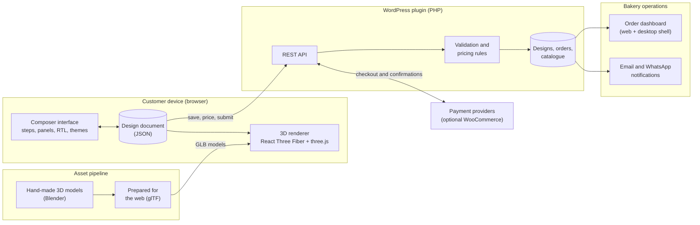

# Architecture

Cake Composer at the level of its main parts and who is responsible for what. Data formats,
API routes, file layout and algorithms are proprietary and left out.

## Overview

The browser draws and edits the design; the server owns everything that has a commercial
consequence: price, validation, orders and payments.

## Components

| Component | Responsibility | Technology |
| --- | --- | --- |
| Composer interface | Guides the customer step by step through structure, flavours, covering, finishes, decorations and review; Arabic, French and English with right-to-left layout | React 18 |
| 3D renderer | Builds the scene from the design document: places the hand-made models and generates the parts that depend on the customer's choices (display tiers, drips, ruffles, piped finishes, borders, lettering, candles); renders only when something changes; adapts quality to the device | three.js via React Three Fiber and drei |
| Design document | The single serialisable description of a cake; the same document is rendered, saved, priced and sent to the bakery | JSON |
| Server plugin | Projects, catalogue, saved designs, pricing and validation, orders, payments, notifications, bakery dashboard | PHP on WordPress |
| 3D assets | Cake tiers, main coverings and pastry decorations modelled by hand, delivered to the browser as glTF | Blender, glTF 2.0 |
| Bakery dashboard | Orders, production capacity, costing, reports, invoices; also wrapped as a desktop application | Web, Tauri 2 |
| Kiosk mode | In-store self-service on a touch screen | React, on-screen keyboard |

## Main decisions

**The server is the authority on price.** The browser shows a price while the customer designs,
but the order uses a price computed again on the server from the submitted design. A modified
client cannot change what the bakery is paid.

**One design, read everywhere.** The 3D view, the price, the saved draft, the order and the
bakery's production view all read the same design document.

**Hand-made where it shows, generated where it varies.** Cake tiers, the main coverings and
pastry decorations are modelled by hand in Blender, because customers judge a cake by its edges
and surface. Parts that must follow every shape, size and choice (display tiers, drips, ruffles,
borders, lettering, candles) are generated by the product while the customer designs.

**Render on demand.** The 3D view only draws when something changes, so a phone isn't busy
while the customer is reading a panel.

**Commerce is optional and detected.** The product works with its own order and payment flow,
and integrates with WooCommerce only when the shop runs it.

**One platform, several configurators.** The gift-box composer reuses the server, catalogue,
ordering and dashboard; only its configurator and 3D scene are its own.

## Technology

| Area | Technology |
| --- | --- |
| Front end | React, React Three Fiber, drei, three.js, Vite |
| Server | PHP, WordPress plugin APIs, REST API |
| Commerce | Server-side pricing; optional WooCommerce; integrated payment providers |
| 3D assets | Blender, glTF 2.0 (GLB) |
| Desktop | Tauri shell around the web dashboard |
| Quality | Automated checks run before each release |
