# Cake Composer: Interactive 3D Cake Configuration & Commerce

A proprietary digital product engineered by Norvy to transform custom cake ordering into a
structured, interactive 3D experience.

Customers design their cake in real-time 3D, preview the intended design before ordering, and
send the bakery the design itself instead of a description. The bakery receives every tier,
flavour and decoration in a structured order, with a price checked on the server.

Cake Composer can be adapted to each business (catalogue, flavours, prices, languages and look)
and integrated into an existing WordPress / WooCommerce shop.

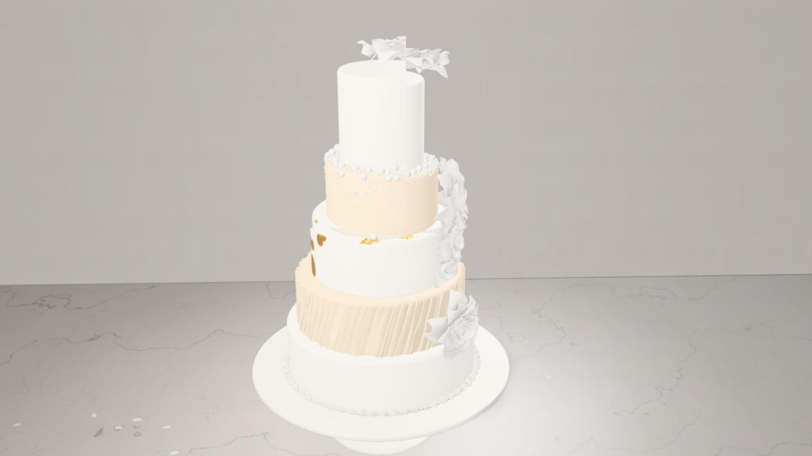

<sub>Composed in Cake Composer and captured from a local installation. Prices in the interface screenshots are test values.</sub>

### Made with Cake Composer

<table>
  <tr>
    <td width="33%">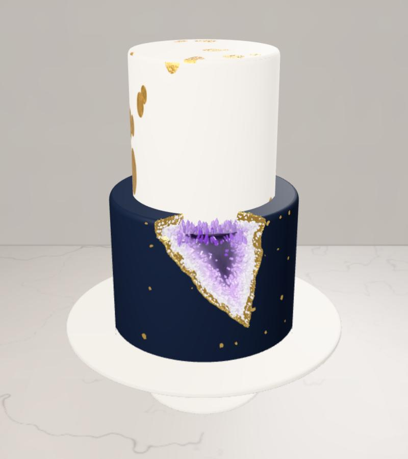</td>
    <td width="33%">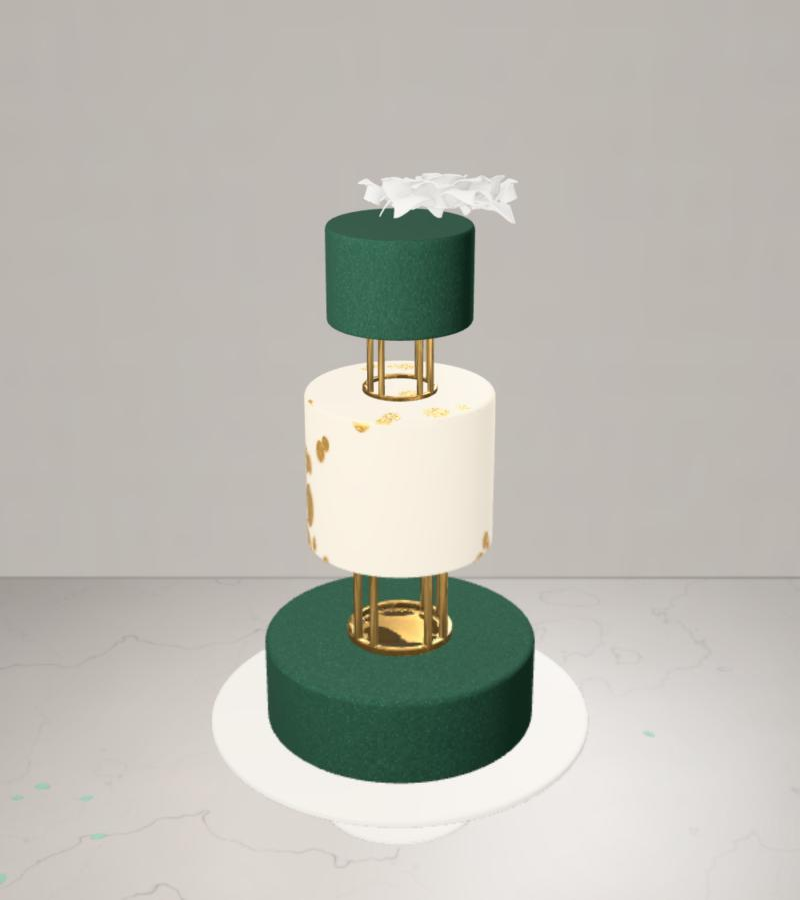</td>
    <td width="33%">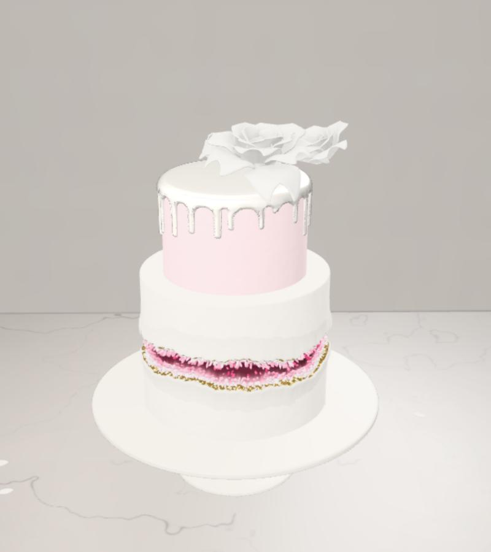</td>
  </tr>
  <tr>
    <td align="center"><sub>Geode opening</sub></td>
    <td align="center"><sub>Floating tiers on separators</sub></td>
    <td align="center"><sub>Fault line</sub></td>
  </tr>
  <tr>
    <td>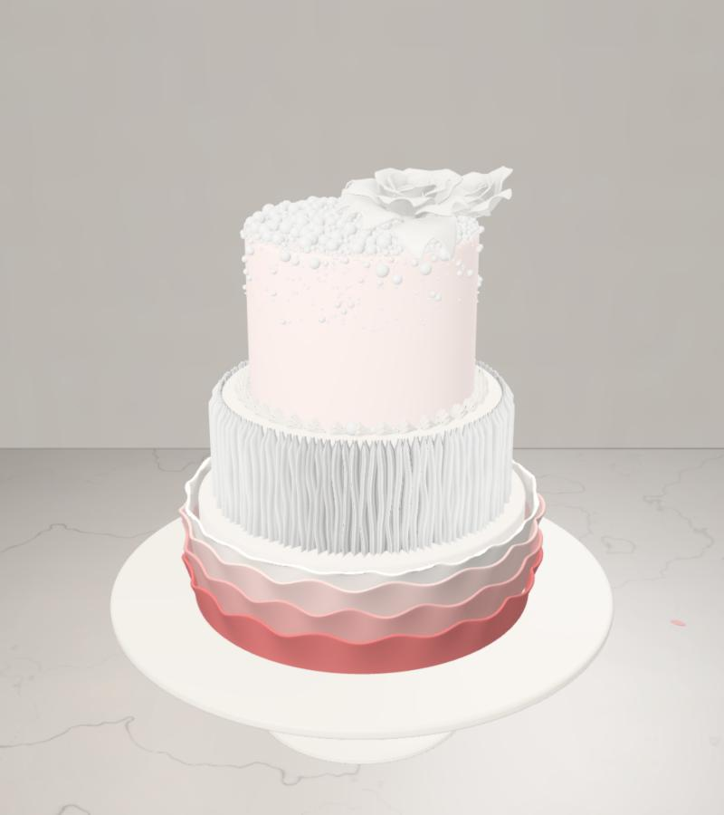</td>
    <td>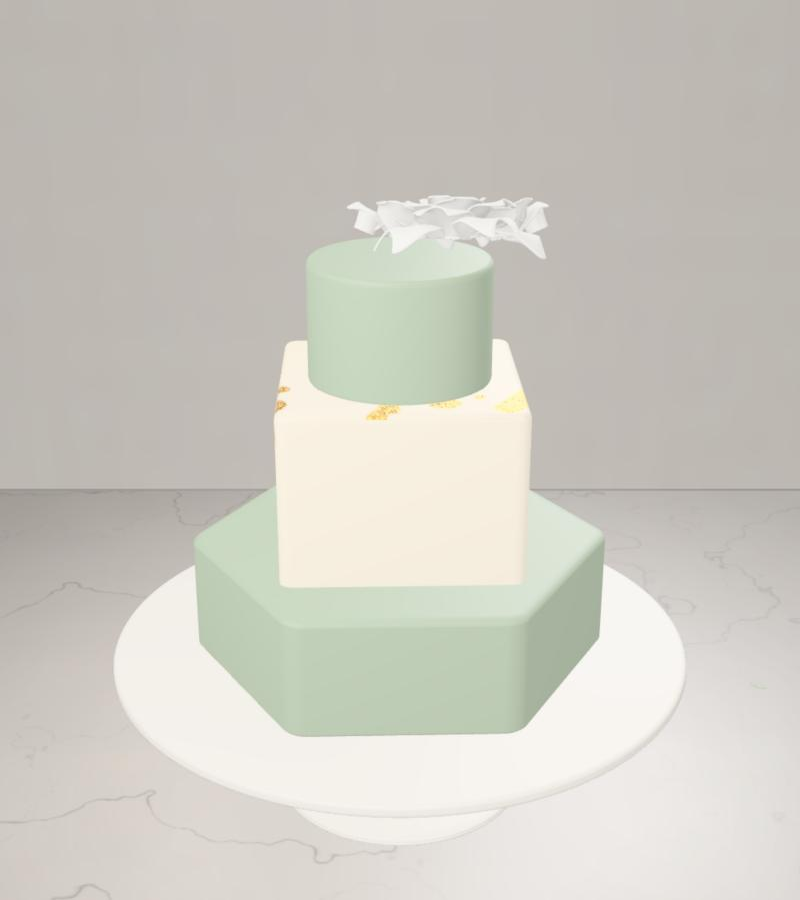</td>
    <td>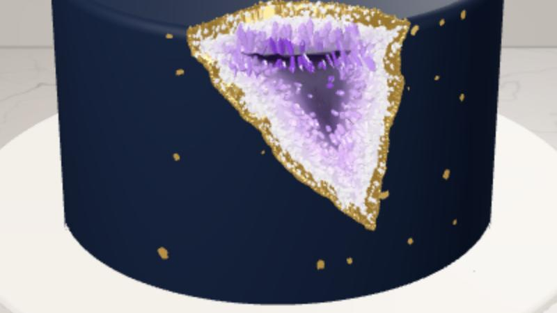</td>
  </tr>
  <tr>
    <td align="center"><sub>Ruffles, piping and fondant</sub></td>
    <td align="center"><sub>Mixed shapes</sub></td>
    <td align="center"><sub>Geode detail</sub></td>
  </tr>
</table>

Every cake above was composed with the product's standard options (coverings, finishes,
separators and decorations) and captured from the running application.

## The business problem

Custom cakes are still ordered mostly by message and phone. The customer describes the cake in
words and a few reference photos, and the bakery interprets them. Details get lost: the flavour
of each tier, the real size of "a cake for thirty people", what "gold details" should look like.
Mistakes are found at pickup, when nothing can be changed.

Part of the motivation came from market research: reading public Google Reviews of patisseries
and bakeries. Complaints about custom orders kept returning to the same themes: a different
flavour from the one requested, and a finished cake that did not match what the customer had
asked for. Cake Composer is built to reduce that ambiguity. See the [case study](docs/case-study.md).

## Product experience

The customer builds the cake step by step: structure, flavours, covering and colour, finishes,
decorations, candles and lettering, cake board, then review and order. The 3D view updates with
every choice.
The screenshots show Pasteluxe, a demo theme; each business gets its own look.

| | |
| --- | --- |
| 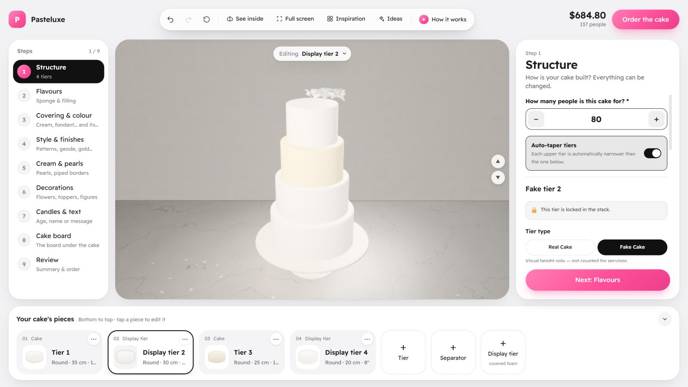 | 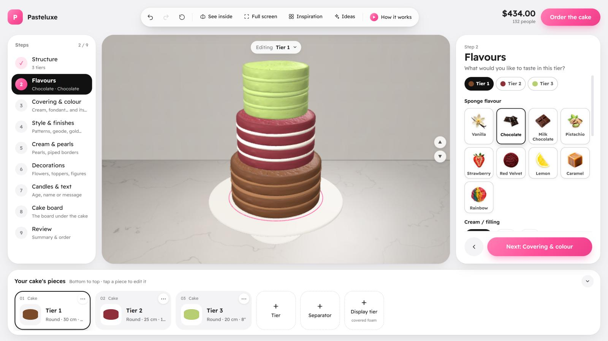 |
| **Structure**: tiers, sizes, shapes, separators, real and display tiers | **Flavours**: sponge and cream chosen per tier and shown in the cake |
| 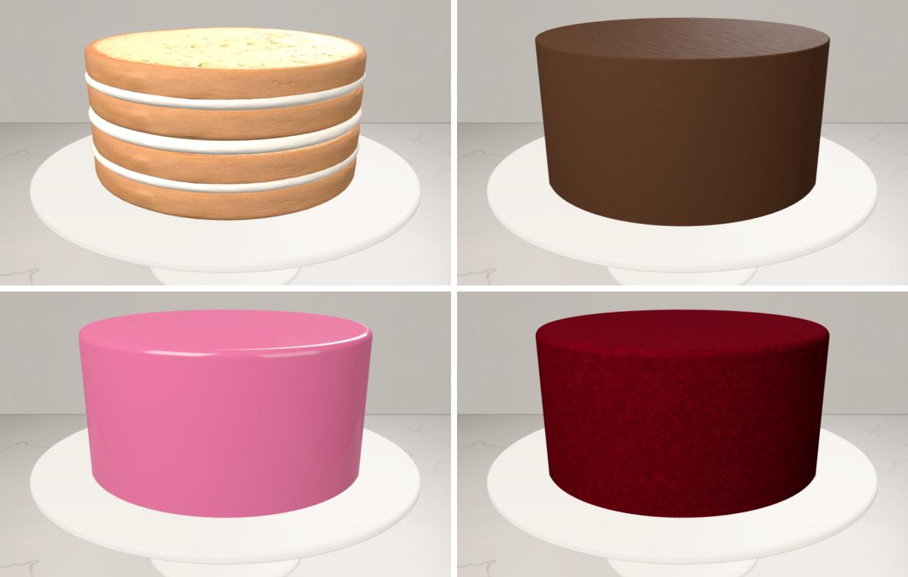 | 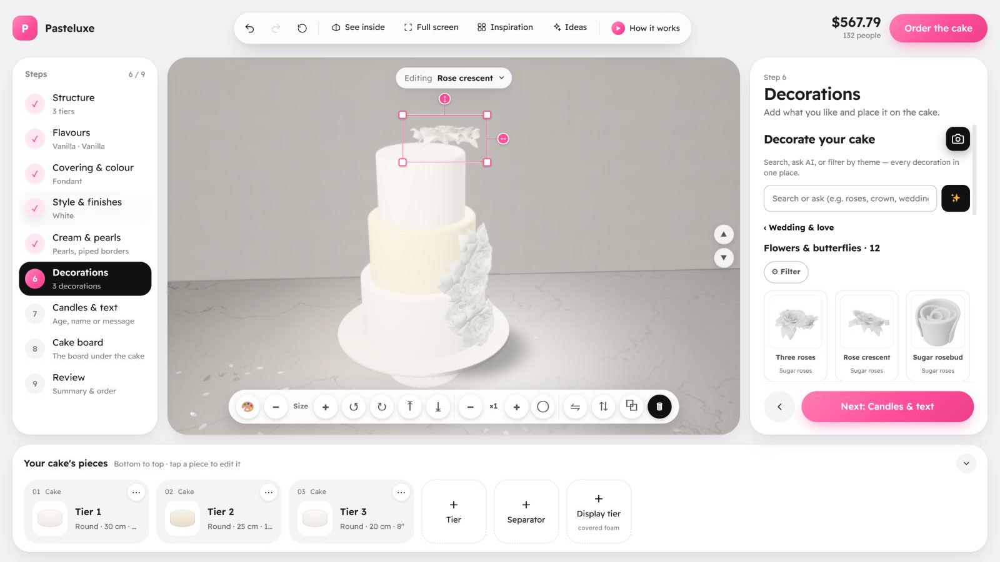 |
| **Coverings**: naked, ganache, mirror glaze, velvet and more | **Decorations**: placed directly on the cake, on the top or the sides |

<p align="center">
  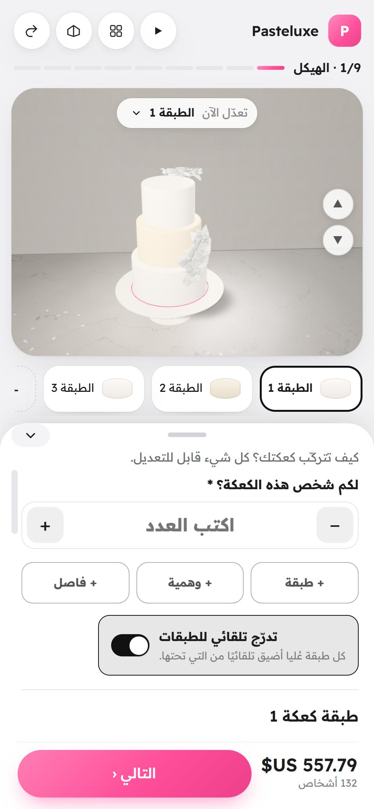
  <br><sub>On a phone, in Arabic, right-to-left.</sub>
</p>

A one-minute, screenshot-based product walkthrough (real captures shown in sequence, not a live
screen recording) is in [`media/video/cake-composer-walkthrough.mp4`](media/video/cake-composer-walkthrough.mp4).
All 12 gallery images and 13 interface screenshots are listed in the [media index](media/INDEX.md).

## Verified capabilities

Checked against the product's code and a running installation, November 2026.

- **Real-time 3D in the browser**, with quality adapted to phones, laptops and desktops.
- **Multi-tier cakes** of up to five tiers, in seven diameters from 10 to 35 cm and several
  heights.
- **Four shapes**: round, square, rectangle and hexagon.
- **Structures**: tier separators and supports, for floating-tier designs.
- **Real and display tiers**: display (dummy) tiers make a cake taller without adding servings.
- **Flavours per tier**: sponge flavours and cream fillings chosen tier by tier and visible
  inside the cake.
- **Coverings**: naked, buttercream, fondant, ganache, chocolate paste, mirror glaze
  and velvet, in a palette of colours.
- **Finishes and decoration**: drips, ruffles, piped patterns, stripes, sprinkles, pearl and
  piped borders, geode and fault-line designs; a library of 3D decorations; lettering; number
  and letter candles.
- **Servings helper** that relates the number of guests to sizes and tiers.
- **Editing comfort**: undo and redo, saved drafts, an inspiration library of ready designs.
- **Arabic, French and English**, with full right-to-left layout.
- **In-store kiosk mode** with an on-screen keyboard and automatic reset.
- **Review and order**: a summary of every tier and choice before the customer orders.

## Custom 3D modelling and craftsmanship

Customers judge a cake by its surface, so the core of the cake is modelled by hand.

**Modelled by hand in Blender**

- The cake tiers, with their sponge and cream layers, for every shape and height.
- The main coverings, such as fondant, buttercream and ganache.
- Pastry decorations such as sugar flowers, fruit and fondant pieces.
- Separator structures between tiers: a crystal chandelier, a crystal curtain and a gold-ring
  stand.

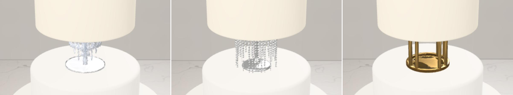

Realistic textures were the hardest part of this work: getting sponge, cream, fondant, velvet
and glaze to read as food rather than plastic.

| | | |
| --- | --- | --- |
| 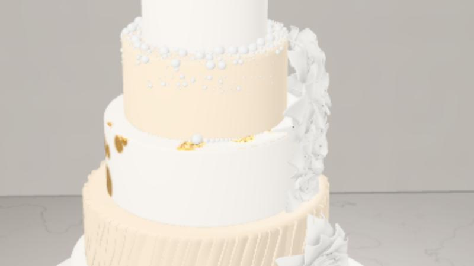 | 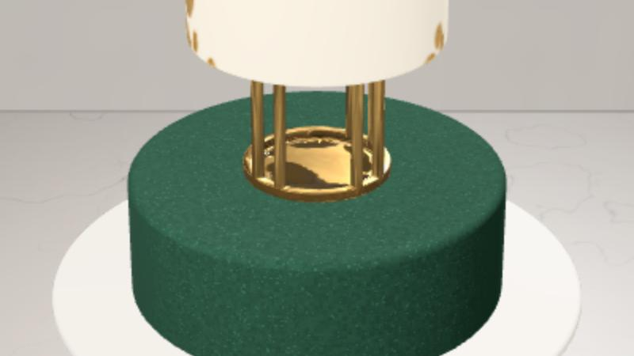 | 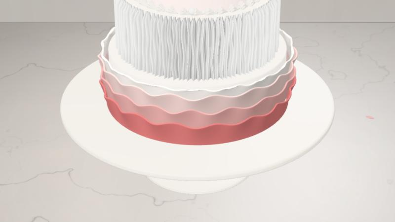 |
| Pearls, draped fondant, gold leaf, sugar roses | Velvet finish and gold-ring separator | Ruffles and piped cream |

**Generated by the product while the customer designs**

- Display tiers, drips, ruffles and piped finishes, sprinkles, borders and pearls.
- Geode and fault-line designs, lettering and number candles.
- The placement of separators and decorations on whichever shape and size the customer chose.

The decoration library combines models made in-house with licensed models prepared for the web.
Models, textures and the way they are made are proprietary and are not included in this
repository.

## Business and e-commerce integration

- **Runs as a WordPress plugin**, so it fits into an existing WordPress site.
- **WooCommerce integration** where the shop uses WooCommerce; it also works without it.
- **Server-checked pricing**: the price is recomputed on the server from the design before
  anything is charged.
- **Online payments** through integrated payment providers, with order and payment tracking.
- **Bakery operations**: an order dashboard (also available as a desktop application),
  production capacity, costing and ingredients, reports and invoices.
- **Notifications** by email and WhatsApp.
- **Adapted to each business**: the shop's own look through themes, its catalogue, flavours,
  prices and languages.
- **A gift-box composer** for boxes of small sweets runs on the same platform.

## Architecture

The browser draws and edits the design; the server owns everything with a commercial
consequence: price, validation, orders and payments. See [ARCHITECTURE.md](ARCHITECTURE.md)
for the diagram and the main decisions.

## Engineering highlights

- Keeping 3D smooth on mid-range phones and on laptops that compile shaders slowly.
- Keeping texture memory within what phones can hold.
- Fitting decorations and finishes to four shapes and every tier height.
- Making undo match what a person considers one change.
- Building Arabic-first screens, including self-service kiosks.

The problems and the general idea behind each fix are in [ENGINEERING.md](ENGINEERING.md).

## Engineering samples

Five small, independent samples written from scratch for this repository. They show how we
approach problems like the ones above. None of them is taken or adapted from the product's code,
and none of them is a cake configurator.

| Sample | Problem |
| --- | --- |
| [webgl-shader-cache](examples/webgl-shader-cache/) | Option switches that re-link GPU shaders and freeze frames |
| [glb-runtime-safety](examples/glb-runtime-safety/) | Texture memory, colour spaces and shared materials in loaded glTF models |
| [device-quality-tiers](examples/device-quality-tiers/) | One 3D view across phones, laptops and desktops |
| [undo-redo-store](examples/undo-redo-store/) | Undo that matches what a person considers one change |
| [rtl-kiosk-kit](examples/rtl-kiosk-kit/) | Arabic-first self-service screens: idle reset, keyboard, money, bidirectional text |

```sh
npm install     # Node 18.17 or later
npm test        # runs every sample's tests
npm run measure # prints the reproducible measurements
npm run bench   # shader benchmark in headless Chromium (see the sample's README)
```

## Commercial availability

Cake Composer is a commercial product. It is not open source and is not offered for download.

**Interested in integrating Cake Composer into your business?**
Explore Norvy's digital products and discuss your business requirements at
https://www.norvyweb.com/

## Intellectual property

© 2026 NORVY WEB LTD. All rights reserved. Cake Composer and Norvy are names of NORVY WEB LTD.

This repository is a showcase. The product's source code, 3D engine, models, textures, catalogue
and business rules are not included. The screenshots and video are provided for presentation
only. See [COPYRIGHT.md](COPYRIGHT.md) and [THIRD_PARTY_NOTICES.md](THIRD_PARTY_NOTICES.md).
